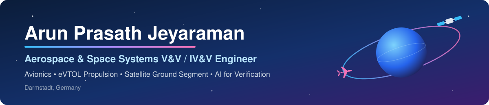

  

  
  
  
  

---

## 👋 About me

I verify software and systems where failure is not an option — from **DO-178C DAL A/B avionics** to **eVTOL electric propulsion certification** and **satellite ground segment data processing**.

My work covers the full V&V lifecycle: requirements analysis and traceability, test planning and execution, structural coverage, verification control documents (VCDs), and compliance with aerospace and space assurance standards. Alongside this, I build **Python and AI-assisted tooling** that makes verification faster, more traceable and easier to report.

---

## 🧭 Career flight path

| | Domain | Highlights |
|:---:|---|---|
| 🛰️ | **Satellite ground segment** — EUMETSAT, MetOp-SG / EPS-SG PDAP *(via Telespazio)* · 2025–present | Integration, Verification & Validation Engineer; **Verification Control Engineer** owning the system-level SRD VCD; automation for product timeliness, completeness and traceability |
| 🚁 | **eVTOL electric propulsion** — Lilium Aerospace · 2024–2025 | Propulsion system certification and verification |
| ✈️ | **Avionics** — Honeywell Aerospace · 13 years | V&V for **Weather Radar, EGPWS, Environment Control Systems and FMS** (DO-178C DAL A/B); SRS ownership, reviews, tool qualification, team lead; on-site Weather Radar V&V in Seattle, USA |
| 💻 | **Career start** — Accord Software and Systems, Bengaluru · 2007 | First industry role |

---

## 🛠️ Skills

<table>
<tr>
<td valign="top" width="50%">

### ✈️ Aerospace

- **Software assurance:** DO-178C (DAL A/B/C)
- **System development:** ARP4754A
- **Airborne hardware:** DO-254
- **Environmental qualification:** DO-160G
- **Airworthiness security:** DO-326A
- Requirements-based testing, MC/DC & structural coverage
- Hardware-in-the-loop testing (dSPACE)
- Tool qualification and certification evidence

</td>
<td valign="top" width="50%">

### 🛰️ Space

- **Space standards:** ECSS
- Ground segment **IV&V** for MetOp-SG / EPS-SG
- **Verification Control Document (VCD)** ownership and close-out
- Requirement-to-test **traceability** across levels
- Product **timeliness & completeness** monitoring
- Log analysis and anomaly investigation automation

</td>
</tr>
</table>

### 📜 Standards

### 🧪 Verification & requirements tools

### ⚙️ Automation & AI

### 🏅 Certifications

---

## 🚀 Featured projects

| Project | What it is |
|---|---|
| 🛰️ [**SatRadar**](https://github.com/jarunprasath/sat-radar) · [▶ live](https://jarunprasath.github.io/sat-radar/) | A "Flightradar for satellites": a mobile-friendly map of every active satellite right now, propagated in the browser with SGP4 from CelesTrak data — plus closest pairs, slowest movers, oldest/newest launches and what's above you. Python tool for data build and terminal analysis |
| ✈️ [**IXM Pulse — Madurai Airport Tracker**](https://github.com/jarunprasath/madurai-airport-tracker) · [▶ live](https://jarunprasath.github.io/madurai-airport-tracker/) | Live flights, daily/monthly traffic, airline-wise data, cargo and a 12-month passenger forecast for Madurai International Airport (IXM), with auto-generated weekly/monthly PowerPoint and Excel reports — built to give citizens and authorities sourced evidence for better connectivity from Madurai |
| 🧰 [**arun_labs**](https://github.com/jarunprasath/arun_labs) | My toolkit of Python scripts and AI-assisted helpers for aerospace V&V: requirement trace database, DO-178C / ARP4754A / DO-254 / DO-160G / DO-326A reference skills, and engineering productivity utilities |
| 🔬 [**ReverseLab**](https://github.com/jarunprasath/ReverseLab) | My customised edition of [REA](https://github.com/morluto/rea) by morluto (MIT): an MCP server and CLI for reverse engineering binaries, apps and runtime behaviour |

---

## 🔭 Currently exploring

- 🤖 **AI-assisted verification** — LLM support for requirement analysis, test review and traceability
- 🛰️ **Ground segment innovation** — tooling for satellite data processing, monitoring and operations
- 📚 Sharing practical V&V knowledge from two decades of safety-critical work

---

  <i>Building reusable tools and sharing knowledge from safety-critical systems verification.</i> 
  ✈️ Avionics → 🚁 eVTOL → 🛰️ Space

